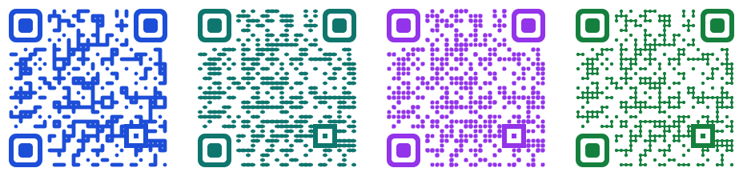

# QR Code Styling (Node)
[](https://www.npmjs.com/package/qr-code-styling-node)
[](https://github.com/ducminhquan/qr-code-styling/actions/workflows/ci.yml)

JavaScript library for generating styled QR codes with a logo: custom dots, corners, gradients and backgrounds.
Works in the browser (canvas or SVG) and on Node.js servers, with a single dependency and one options object.

`qr-code-styling-node` is an independently maintained project. It started as a fork of
[qr-code-styling](https://github.com/kozakdenys/qr-code-styling) by Denys Kozak and keeps its API,
so code written for either package keeps working. See [CHANGELOG.md](CHANGELOG.md) for what changed.

Found a bug or have an idea? [Open an issue](https://github.com/ducminhquan/qr-code-styling/issues).
### Examples
<p float="left">


</p>

### Installation

```
npm install qr-code-styling-node
```

### Usage

```HTML
<!DOCTYPE html>
<html lang="en">
<head>
    <meta charset="UTF-8">
    <title>QR Code Styling</title>
    <script type="text/javascript" src="https://unpkg.com/qr-code-styling-node@1.9.0/lib/qr-code-styling.js"></script>
</head>
<body>
<div id="canvas"></div>
<script type="text/javascript">

    const qrCode = new QRCodeStyling({
        width: 300,
        height: 300,
        type: "svg",
        data: "https://www.facebook.com/",
        image: "https://upload.wikimedia.org/wikipedia/commons/5/51/Facebook_f_logo_%282019%29.svg",
        dotsOptions: {
            color: "#4267b2",
            type: "rounded"
        },
        backgroundOptions: {
            color: "#e9ebee",
        },
        imageOptions: {
            crossOrigin: "anonymous",
            margin: 20
        }
    });

    qrCode.append(document.getElementById("canvas"));
    qrCode.download({ name: "qr", extension: "svg" });
</script>
</body>
</html>
```
---

### Using with a bundler or TypeScript

```js
import QRCodeStyling, { dotTypes } from "qr-code-styling-node";

const qrCode = new QRCodeStyling({ data: "https://example.com", dotsOptions: { type: dotTypes.rounded } });
qrCode.append(document.getElementById("canvas"));
```

The package ships an ES module build (`import`), a CommonJS/UMD build (`require` and `<script>`) and TypeScript types.

---

### React and Vue

The core stays framework-free. Thin wrappers ship in the same package; React and Vue are optional peer dependencies.

```jsx
import { QRCode } from "qr-code-styling-node/react";

function Poster() {
  const qr = useRef();
  return (
    <>
      <QRCode ref={qr} options={{ data: "https://example.com", dotsOptions: { type: "fluid" } }} />
      <button onClick={() => qr.current.download({ extension: "png" })}>Download</button>
    </>
  );
}
```

```vue
<script setup>
import { ref } from "vue";
import { QRCode } from "qr-code-styling-node/vue";
const qr = ref();
const options = ref({ data: "https://example.com", shape: "circle" });
</script>

<template>
  <QRCode ref="qr" :options="options" @update="(qrCode) => console.log('drawn', qrCode)" />
  <button @click="qr.share({ name: 'qr' })">Share</button>
</template>
```

Both redraw only when the options really change (a new but equal object does not redraw). The React ref is the
`QRCodeStyling` instance; the Vue ref exposes `qrCode`, `download`, `share` and `getRawData`.

### More styles, frames and labels


New dot types `diamond`, `small-square`, `vertical-lines` and `horizontal-lines`, and a `rounded` type for both corner
options. A frame, a label and a plate behind the logo:

```js
const qrCode = new QRCodeStyling({
    data: "https://example.com",
    dotsOptions: { type: "rounded", color: "#1d4ed8" },
    cornersSquareOptions: { type: "rounded" },
    frameOptions: { color: "#1d4ed8", radius: 24 },
    labelOptions: { text: "SCAN ME" },
    image: "https://example.com/logo.svg",
    imageOptions: { backgroundColor: "#ffffff", backgroundRadius: 0.5 }
});
```

The frame and label are drawn inside `width` x `height`; the code shrinks to fit.

`frameOptions` structure

Property|Type  |Default Value      |Description
--------|------|-------------------|--------------------------------------------
color   |string|`'#000'`           |Frame and label band color
width   |number|4% of the size     |Border thickness in px
radius  |number|`0`                |Outer corner radius in px
padding |number|4% of the size     |Space between the frame and the code in px

`labelOptions` structure

Property  |Type                       |Default Value                       |Description
----------|---------------------------|------------------------------------|-----------------------------
text      |string                     |                                    |The text. Required
position  |string (`'top' 'bottom'`) |`'bottom'`                          |Where the label goes
color     |string                     |white on a frame, else the dots color|Text color
fontSize  |number                     |7% of the size                      |In px
fontFamily|string                     |`'Helvetica, Arial, sans-serif'`    |
fontWeight|string or number           |`'bold'`                            |

### Connected and decorative dots



`fluid` joins neighbouring dots into soft strokes, `wave` chains each row into soft beads, `blob` gives every
module its own hand-drawn corners, and `circuit` draws round pads with thin traces to their neighbours. With
these four, finders and alignment patterns are drawn solid and rounded (unless you set a corner type), so the
code keeps scanning.

### Smaller SVG files

`svgOptions: { mergePaths: true }` draws all dots as one `<path>` instead of one element per module (and does
the same for finders drawn with dots). The picture is the same; files are 15-50% smaller and render faster,
which helps when a page shows many codes.

```js
new QRCodeStyling({ type: "svg", data: "https://example.com", svgOptions: { mergePaths: true } });
```

### QR art


Blend a picture into the code with `art`. Three modes:

- `halftone` (default): the picture is redrawn as fine pixels, with each QR module kept in the middle. Use `colored: true` to keep the picture's colors.
- `colorize`: dots keep their shape (any `dotsOptions.type`) and are painted with a darkened copy of the picture, over a light copy of it.
- `blend`: the picture fills the whole image, like an illustration. Dots are drawn only where the picture is not already
  dark or light enough for the code; finders take a dark color from the picture and sit on a light plate.
  Use `placement` to put the code in one part of a larger picture.


```js
const qrCode = new QRCodeStyling({
    width: 760,
    height: 300,
    data: "https://example.com",
    dotsOptions: { type: "dots" }, // round dots give round finders in blend mode
    art: { image: "poster.jpg", mode: "blend", placement: { x: 510, y: 40, size: 220 } }
});
```

```js
const qrCode = new QRCodeStyling({
    data: "https://example.com",
    qrOptions: { errorCorrectionLevel: "H" }, // recommended for art
    art: { image: "https://example.com/photo.jpg", mode: "halftone", colored: true },
    imageOptions: { crossOrigin: "anonymous" } // the picture must be readable by a canvas
});
```

QR art reads the picture's pixels, so it needs a canvas: it works as is in the browser, and on Node it needs
`nodeCanvas`. Pictures from another origin need CORS (`crossOrigin`), or the browser will block reading them.

`art` structure

Property  |Type                              |Default Value|Description
----------|----------------------------------|-------------|------------------------------------------------------------
image     |string                            |             |The picture (URL or data URL). Required
mode      |string (`'halftone' 'colorize' 'blend'`)|`'halftone'` |How the picture is blended in
colored   |boolean                           |`false`      |halftone: use the picture's colors instead of dots/background colors
background|boolean                           |`true`       |colorize: show a light copy of the picture behind the dots
contrast  |number (`0 - 1`)                  |`0.5` halftone, `0.7` colorize, `0.6` blend|Higher is easier to scan but shows less of the picture
crossOrigin|string                          |             |Overrides `imageOptions.crossOrigin` for the picture
placement |object `{ x, y, size }`          |             |Put the code in this square (in pixels) instead of the middle; the margin is ignored. Mostly for `blend`

Always check art codes with `verify()` below: a picture with large mid-grey areas or very small modules
(under about 7 px) may need a higher `contrast`, a larger size or a higher error correction level.

### Round QR codes


`shape: "circle"` draws a round code. The real code stays square in the middle, with an empty ring around it so
scanners still find it, and the rest of the circle is filled with decorative dots in the same style. The background
becomes a circle too. The decoration is the same every time for the same data.

```js
new QRCodeStyling({ data: "https://example.com", shape: "circle", dotsOptions: { type: "rounded" } });
```

A round code uses smaller modules than a square one of the same size, so keep it at least ~240 px for short data and
check it with `verify()`.

### Wi-Fi, contacts, events and more

`QRCodeStyling.payload` (also exported as `payload`) builds the text that phones understand. Pass the result as `data`.

```js
const { payload } = QRCodeStyling;

payload.wifi({ ssid: "LongChau-Guest", password: "secret" });     // WIFI:T:WPA;S:LongChau-Guest;P:secret;;
payload.vCard({ firstName: "Quân", lastName: "Nguyễn", phone: "+84900000000", email: "a@example.com" });
payload.event({ title: "Khai trương", start: "2026-12-01T09:00:00+07:00", end: "2026-12-01T11:00:00+07:00" });
payload.email({ to: "cskh@example.com", subject: "Hỏi đáp" });
payload.phone("1800 6928");
payload.sms({ number: "+84900000000", message: "Xin chào" });
payload.geo({ latitude: 10.7769, longitude: 106.7009 });
```

Special characters are escaped for each format. Text outside Latin-1 (Vietnamese, emoji...) is encoded as UTF-8.

### Sharing on phones

`share()` opens the phone's share sheet with the code as an image (Web Share API), so people can send it to a chat
app or save it to Photos. Where sharing files is not supported, it downloads the file instead.

```js
const result = await qrCode.share({ name: "wifi", extension: "png", title: "Wi-Fi Long Châu" });
// "shared", "cancelled" or "downloaded"
```

### Plugins

A plugin is a plain object with two optional hooks. `configure(options)` returns option changes to merge in before
drawing. `afterDraw(draw)` draws on top of the finished code, with the canvas context or the SVG element. It gets
the code's area in pixels (`x`, `y`, `size`, `dotSize`, `count`), and that area accounts for frames.

```js
const ring = {
  name: "ring",
  configure: (options) => (options.margin < 24 ? { margin: 24 } : undefined),
  afterDraw: ({ type, area, context, svg, document }) => {
    const cx = area.x + area.size / 2, cy = area.y + area.size / 2, r = area.size * 0.75;
    if (type === "canvas") {
      context.beginPath();
      context.arc(cx, cy, r, 0, Math.PI * 2);
      context.strokeStyle = "#e11d48";
      context.stroke();
    } else {
      const circle = document.createElementNS("http://www.w3.org/2000/svg", "circle");
      Object.entries({ cx, cy, r, fill: "none", stroke: "#e11d48" }).forEach(([k, v]) => circle.setAttribute(k, v));
      svg.appendChild(circle);
    }
  }
};

new QRCodeStyling({ data: "https://example.com", plugins: [ring] });
```

Plugins run in order, and async `afterDraw` hooks are awaited. `configure` runs again on every `update()`, so it
should return the same changes for the same options. Check the result with `verify()` when a plugin draws near
the code.

### Checking that a code scans

`verify()` renders the code and decodes it with a QR decoder you pass in, so the library itself stays dependency-free.
It works with any decoder that has the [jsQR](https://www.npmjs.com/package/jsqr) signature.

```js
import jsQR from "jsqr";

const result = await qrCode.verify({ decoder: jsQR });
// { readable: true, decoded: "https://example.com", attempts: 1 }

// For QR art: raise art.contrast step by step until the code scans, and keep that setting.
const tuned = await qrCode.verify({ decoder: jsQR, adjust: true });
// { readable: true, decoded: "...", contrast: 0.8, attempts: 3 }
```

On Node, `verify()` needs `nodeCanvas` or `resvg` to draw the code. A decoder succeeding is a good sign, not a
guarantee: phone cameras are usually more forgiving than jsQR, but print size, light and screen glare matter too.

### API Documentation

#### QRCodeStyling instance
`new QRCodeStyling(options) => QRCodeStyling`

Param  |Type  |Description
-------|------|------------
options|object|Init object

`options` structure

Property               |Type                     |Default Value|Description
-----------------------|-------------------------|-------------|-----------------------------------------------------
width                  |number                   |`300`        |Size of canvas
height                 |number                   |`300`        |Size of canvas
type                   |string (`'canvas' 'svg'`)|`canvas`     |The type of the element that will be rendered
shape                  |string (`'square' 'circle'`)|`'square'` |`'circle'` draws a round code with decorative dots around the real one
svgOptions             |object `{ mergePaths }`  |             |SVG only: `mergePaths: true` draws all dots as one path (smaller files)
plugins                |array                    |             |Plugins with `configure` and `afterDraw` hooks, see [Plugins](#plugins)
data                   |string                   |             |The date will be encoded to the QR code
image                  |string                   |             |The image will be copied to the center of the QR code
margin                 |number                   |`0`          |Margin around canvas
qrOptions              |object                   |             |Options will be passed to `qrcode-generator` lib
imageOptions           |object                   |             |Specific image options, details see below
dotsOptions            |object                   |             |Dots styling options
cornersSquareOptions   |object                   |             |Square in the corners styling options
cornersDotOptionsHelper|object                   |             |Dots in the corners styling options
backgroundOptions      |object                   |             |QR background styling options
nodeCanvas             |node-canvas              |             |Node only, optional. Needed for canvas output (png, jpeg, webp) on a server, see the Node section below
jsdom                  |jsdom                    |             |Node only, optional. Not needed for svg any more; still accepted for backward compatibility
resvg                  |`Resvg` from `@resvg/resvg-js`|        |Node only, optional. Produces png without node-canvas, see the Node section below
art                    |object                   |             |Blend a picture into the code, see "QR art" above
frameOptions           |object                   |             |Border around the code, see "Frames and labels" above
labelOptions           |object                   |             |Text above or below the code, see "Frames and labels" above

`options.qrOptions` structure

Property            |Type                                              |Default Value
--------------------|--------------------------------------------------|-------------
typeNumber          |number (`0 - 40`)                                 |`0`
mode                |string (`'Numeric' 'Alphanumeric' 'Byte' 'Kanji'`)|
errorCorrectionLevel|string (`'L' 'M' 'Q' 'H'`)                        |`'Q'`

`options.imageOptions` structure

Property          |Type                                   |Default Value|Description
------------------|---------------------------------------|-------------|------------------------------------------------------------------------------
hideBackgroundDots|boolean                                |`true`       |Hide all dots covered by the image
imageSize         |number                                 |`0.4`        |Coefficient of the image size. Not recommended to use ove 0.5. Lower is better
margin            |number                                 |`0`          |Margin of the image in px
crossOrigin       |string(`'anonymous' 'use-credentials'`)|             |Set "anonymous" if you want to download QR code from other origins.
saveAsBlob        |boolean                                |`false`      |Saves image as base64 blob in svg type, see bellow
backgroundColor   |string                                 |             |Draws a plate of this color behind the image
backgroundRadius  |number (`0 - 0.5`)                     |`0.2`        |Corner radius of the plate, relative to its size. `0.5` is round

When QR type is svg, the image may not load in certain applications as it is saved as a url, and some svg applications will not render url images for security reasons. Setting `saveAsBlob` to true will instead save the image as a blob, allowing it to render correctly in more places, but will also increase the file size.

`options.dotsOptions` structure

Property|Type                                                                          |Default Value|Description
--------|------------------------------------------------------------------------------|-------------|-------------------
color   |string                                                                        |`'#000'`     |Color of QR dots
gradient|object                                                                        |             |Gradient of QR dots
type    |string (`'rounded' 'dots' 'classy' 'classy-rounded' 'square' 'extra-rounded' 'diamond' 'small-square' 'vertical-lines' 'horizontal-lines' 'fluid' 'wave' 'blob' 'circuit'`)|`'square'`   |Style of QR dots. With `diamond`, `small-square` and the lines, corners and alignment patterns stay solid unless you set a corner type. With `fluid`, `wave`, `blob` and `circuit` they are solid and rounded

`options.backgroundOptions` structure

Property|Type  |Default Value
--------|------|-------------
color   |string|`'#fff'`
gradient|object|

`options.cornersSquareOptions` structure

Property|Type                                     |Default Value|Description
--------|-----------------------------------------|-------------|-----------------
color   |string                                   |             |Color of Corners Square
gradient|object                                   |             |Gradient of Corners Square
type    |string (`'dot' 'square' 'extra-rounded' 'rounded'`)|             |Style of Corners Square

`options.cornersDotOptions` structure

Property|Type                     |Default Value|Description
--------|-------------------------|-------------|-----------------
color   |string                   |             |Color of Corners Dot
gradient|object                   |             |Gradient of Corners Dot
type    |string (`'dot' 'square' 'rounded'`)|             |Style of Corners Dot

Gradient structure

`options.dotsOptions.gradient`

`options.backgroundOptions.gradient`

`options.cornersSquareOptions.gradient`

`options.cornersDotOptions.gradient`

Property  |Type                        |Default Value|Description
----------|----------------------------|-------------|---------------------------------------------------------
type      |string (`'linear' 'radial'`)|"linear"     |Type of gradient spread
rotation  |number                      |0            |Rotation of gradient in radians (Math.PI === 180 degrees)
colorStops|array of objects            |             |Gradient colors. Example `[{ offset: 0, color: 'blue' }, {  offset: 1, color: 'red' }]`

Gradient colorStops structure

`options.dotsOptions.gradient.colorStops[]`

`options.backgroundOptions.gradient.colorStops[]`

`options.cornersSquareOptions.gradient.colorStops[]`

`options.cornersDotOptions.gradient.colorStops[]`

Property|Type            |Default Value|Description
--------|----------------|-------------|-----------------------------------
offset  |number (`0 - 1`)|             |Position of color in gradient range
color   |string          |             |Color of stop in gradient range

#### QRCodeStyling methods
`QRCodeStyling.append(container) => void`

Param    |Type       |Description
---------|-----------|-----------
container|DOM element|This container will be used for appending of the QR code

`QRCodeStyling.getRawData(extension) => Promise<Blob>`

Param    |Type                                |Default Value|Description
---------|------------------------------------|-------------|------------
extension|string (`'png' 'jpeg' 'webp' 'svg'`)|`'png'`      |Blob type on browser, Buffer type on Node

`QRCodeStyling.verify({ decoder, adjust }) => Promise<{ readable, decoded, contrast, attempts }>`

Param  |Type    |Description
-------|--------|--------------------------------------------------------------
decoder|function|A QR decoder with the jsQR signature `(rgba, width, height) => { data } \| null`
adjust |boolean |For QR art: raise `art.contrast` until the code scans. Default `false`

`QRCodeStyling.share({ name, extension, title, text }) => Promise<'shared' | 'cancelled' | 'downloaded'>`

Param    |Type                                |Default Value|Description
---------|------------------------------------|-------------|------------
name     |string                              |`'qr'`       |File name, without extension
extension|string (`'png' 'jpeg' 'webp' 'svg'`)|`'png'`      |File type
title    |string                              |             |Title for the share sheet
text     |string                              |             |Text for the share sheet

`QRCodeStyling.update(options) => void`

Param  |Type  |Description
-------|------|--------------------------------------
options|object|The same options as for initialization

`QRCodeStyling.download(downloadOptions) => Promise<void>`

Param          |Type  |Description
---------------|------|------------
downloadOptions|object|Options with extension and name of file (not required)

Promise returned will resolve into the data URI of the QR code image.

`downloadOptions` structure

Property |Type                                |Default Value|Description
---------|------------------------------------|-------------|-----------------------------------------------------
name     |string                              |`'qr'`       |Name of the downloaded file
extension|string (`'png' 'jpeg' 'webp' 'svg'`)|`'png'`      |File extension

### Node Support

#### SVG with no extra packages

On Node.js, SVG output works out of the box: no `jsdom` and no `canvas` are needed, and it is about
6 times faster than going through jsdom. `getRawData` returns a Buffer on Node (a Blob where `Buffer` does not exist).
Other runtimes without a DOM should work the same way, but only Node.js is tested.

```js
const QRCodeStyling = require("qr-code-styling-node");
const fs = require("fs");

const qrCode = new QRCodeStyling({
    type: "svg",
    data: "https://example.com",
    image: "https://example.com/logo.png", // data URLs and http(s) URLs work; remote images use fetch
    dotsOptions: { color: "#4267b2", type: "rounded" },
    imageOptions: { saveAsBlob: true, margin: 8 } // saveAsBlob embeds the logo inside the SVG
});

qrCode.getRawData("svg").then((buffer) => fs.writeFileSync("qr.svg", buffer));
```

#### PNG without node-canvas

`node-canvas` needs native system libraries. If you only need png, install `@resvg/resvg-js` instead
(prebuilt binaries, nothing to compile) and pass its `Resvg` class:

```js
const QRCodeStyling = require("qr-code-styling-node");
const { Resvg } = require("@resvg/resvg-js");
const fs = require("fs");

const qrCode = new QRCodeStyling({ data: "https://example.com", resvg: Resvg });
qrCode.getRawData("png").then((buffer) => fs.writeFileSync("qr.png", buffer));
```

#### With node-canvas (png, jpeg, webp) and jsdom

This is the original 1.5.0 way and keeps working unchanged.
Pass the node-canvas module for canvas output. Passing `jsdom` for svg is optional now.
You must pass both if using `imageOptions.saveAsBlob` with jsdom.

`canvas` and `jsdom` are not dependencies of this package; install the ones you need (`npm install canvas jsdom`).

```js
const QRCodeStyling = require("qr-code-styling-node");
// The 1.5.0 style import keeps working too:
// const { QRCodeStyling } = require("qr-code-styling-node/lib/qr-code-styling.common.js");
const nodeCanvas = require("canvas");
const { JSDOM } = require("jsdom");
const fs = require("fs");

const options = {
    width: 300,
    height: 300,
    data: "https://www.facebook.com/",
    image: "https://upload.wikimedia.org/wikipedia/commons/5/51/Facebook_f_logo_%282019%29.svg",
    dotsOptions: {
        color: "#4267b2",
        type: "rounded"
    },
    backgroundOptions: {
        color: "#e9ebee",
    },
    imageOptions: {
        crossOrigin: "anonymous",
        margin: 20
    }
}

// For canvas type
const qrCodeImage = new QRCodeStyling({
    nodeCanvas, // this is required
    ...options
});

qrCodeImage.getRawData("png").then((buffer) => {
  fs.writeFileSync("test.png", buffer);
});

// For svg type
const qrCodeSvg = new QRCodeStyling({
    jsdom: JSDOM, // this is required
    type: "svg",
    ...options
});

qrCodeSvg.getRawData("svg").then((buffer) => {
  fs.writeFileSync("test.svg", buffer);
});

// For svg type with the inner-image saved as a blob
// (inner-image will render in more places but file will be larger)
const qrCodeSvgWithBlobImage = new QRCodeStyling({
    jsdom: JSDOM, // this is required
    nodeCanvas, // this is required
    type: "svg",
    ...options,
    imageOptions: {
        saveAsBlob: true,
        crossOrigin: "anonymous",
        margin: 20
    }
});

qrCodeSvgWithBlobImage.getRawData("svg").then((buffer) => {
  fs.writeFileSync("test_blob.svg", buffer);
});

```

### License

[MIT License](LICENSE). Copyright (c) 2019 Denys Kozak (original qr-code-styling) and qr-code-styling-node contributors.

