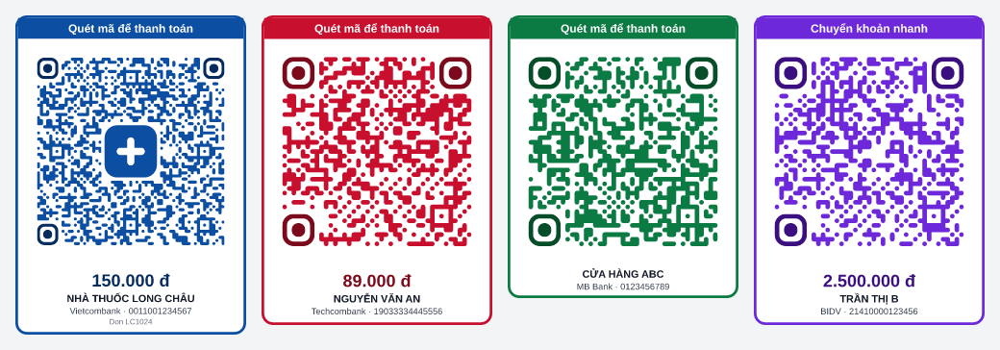

# QR Code Styling (Node)

[](https://www.npmjs.com/package/qr-code-styling-node)
[](https://github.com/ducminhquan/qr-code-styling/actions/workflows/ci.yml)

Styled QR codes from one options object: dots, corners, colors, gradients, logos, frames, labels, round codes
and QR art. Works in the browser (canvas or SVG) and on Node.js, with a single dependency.

**[Try it in the playground](https://ducminhquan.github.io/qr-code-styling/)** — change options live, download
the result and copy the code.

<p float="left">


</p>


**Why this library**

- **One options object.** Everything is an option; nothing to compose or subclass.
- **Framework-free and light.** One dependency (`qrcode-generator`). React and Vue wrappers are optional.
- **Pretty out of the box.** 14 dot styles, rounded corners, gradients, logos, frames, labels, round, heart and other shaped codes, and QR art.
- **Runs anywhere.** Browser canvas or SVG; on Node, SVG works with no extra packages, PNG with `resvg` or `node-canvas`.
- **Checks itself.** `check()` flags low contrast, big logos and tiny prints instantly; `verify()` decodes the result so you know a styled code still scans.
- **Ready for shops.** VietQR bank transfers with ready-made payment cards, GS1 Digital Link product codes, and printable label sheets (PDF) from a CSV file, in code or with `npx`.
- **Backward compatible.** Code written for 1.5.0 (or for the original `qr-code-styling`) keeps working and draws the same picture. New behaviour is always opt-in.

`qr-code-styling-node` is an independently maintained project. It started as a fork of
[qr-code-styling](https://github.com/kozakdenys/qr-code-styling) by Denys Kozak and keeps its API.
See [CHANGELOG.md](CHANGELOG.md) for what changed. Found a bug or have an idea?
[Open an issue](https://github.com/ducminhquan/qr-code-styling/issues).

## Contents

- [Installation](#installation)
- [Quick start](#quick-start): [browser](#in-the-browser), [bundler / TypeScript](#with-a-bundler-or-typescript), [React and Vue](#react-and-vue), [Node.js](#on-nodejs)
- Guides: [dots and corners](#dots-and-corners), [frames and labels](#frames-and-labels), [round codes and other shapes](#round-codes-and-other-shapes),
  [QR art](#qr-art), [Wi-Fi, contacts and events](#wi-fi-contacts-events-and-more), [download and share](#download-and-share),
  [VietQR payments](#vietqr-bank-transfers), [GS1 product codes](#gs1-digital-link-product-codes),
  [checking that a code scans](#checking-that-a-code-scans), [printing many codes](#printing-many-codes),
  [command line](#command-line), [smaller SVG files](#smaller-svg-files), [plugins](#plugins)
- [API reference](#api-reference)
- [Upgrading from 1.5.0](#upgrading-from-150)
- [Development](#development)

## Installation

```
npm install qr-code-styling-node
```

Or load it from a CDN with a `<script>` tag. It defines a global `QRCodeStyling`:

```html
<script src="https://unpkg.com/qr-code-styling-node/lib/qr-code-styling.js"></script>
```

## Quick start

### In the browser

```html
<div id="qr"></div>
<script src="https://unpkg.com/qr-code-styling-node/lib/qr-code-styling.js"></script>
<script>
  const qrCode = new QRCodeStyling({
    width: 300,
    height: 300,
    type: "svg",
    data: "https://nhathuoclongchau.com.vn",
    image: "https://example.com/logo.svg",
    dotsOptions: { type: "rounded", color: "#1d4ed8" },
    cornersSquareOptions: { type: "extra-rounded" },
    backgroundOptions: { color: "#ffffff" },
    imageOptions: { crossOrigin: "anonymous", margin: 8 }
  });

  qrCode.append(document.getElementById("qr"));
  // later: qrCode.update({ data: "https://fptshop.com.vn" });
  // qrCode.download({ name: "qr", extension: "png" });
</script>
```

### With a bundler or TypeScript

```js
import QRCodeStyling, { dotTypes, payload } from "qr-code-styling-node";

const qrCode = new QRCodeStyling({ data: "https://example.com", dotsOptions: { type: dotTypes.fluid } });
qrCode.append(document.getElementById("qr"));
```

The package ships an ES module build (`import`), a CommonJS/UMD build (`require` and `<script>`) and TypeScript
types for every option.

### React and Vue

The core stays framework-free. Thin wrappers (about 2 KB each) ship in the same package; React and Vue are
optional peer dependencies.

```jsx
import { useRef } from "react";
import { QRCode } from "qr-code-styling-node/react";

function Poster() {
  const qr = useRef();
  return (
    <>
      <QRCode ref={qr} options={{ data: "https://example.com", dotsOptions: { type: "fluid" } }} />
      <button onClick={() => qr.current.download({ extension: "png" })}>Download</button>
    </>
  );
}
```

```vue
<script setup>
import { ref } from "vue";
import { QRCode } from "qr-code-styling-node/vue";

const qr = ref();
const options = ref({ data: "https://example.com", shape: "circle" });
</script>

<template>
  <QRCode ref="qr" :options="options" @update="(qrCode) => console.log('drawn', qrCode)" />
  <button @click="qr.share({ name: 'qr' })">Share</button>
</template>
```

Both redraw only when the options really change: a new but equal object does not redraw. The React ref is the
`QRCodeStyling` instance (with an `onUpdate` prop called after each draw); the Vue ref exposes `qrCode`,
`download`, `share` and `getRawData`, and the component emits `update`.

**Server rendering.** With Next.js, Remix, Nuxt or plain Vue SSR the code is already in the server HTML, so it
shows before any JavaScript runs; the browser then swaps in the live code without hydration warnings.

- Vue draws every code on the server, logo, frame and label included.
- React renders synchronously, so it puts plain codes (dots, corners, colors, gradients, shapes) in the HTML by
  itself. For a code with a logo, art, a frame or a label, make the markup in a server component or loader and
  pass it as `svg`:

```jsx
// Next.js app router: a server component
import QRCodeStyling from "qr-code-styling-node";
import { QRCode } from "qr-code-styling-node/react";

export default async function Poster() {
  const options = { data: "https://example.com", image: "https://example.com/logo.png" };
  const svg = await new QRCodeStyling({ ...options, type: "svg" }).getSVGString();
  return <QRCode options={options} svg={svg} />;
}
```

### On Node.js

SVG works with no extra packages. `getRawData` returns a `Buffer` on Node.

```js
const QRCodeStyling = require("qr-code-styling-node");
const fs = require("fs");

const qrCode = new QRCodeStyling({
  type: "svg",
  data: "https://example.com",
  image: "https://example.com/logo.png", // data URLs and http(s) URLs work (remote images use fetch)
  dotsOptions: { type: "rounded", color: "#4267b2" },
  imageOptions: { saveAsBlob: true, margin: 8 } // embeds the logo inside the SVG
});

qrCode.getRawData("svg").then((buffer) => fs.writeFileSync("qr.svg", buffer));
```

For PNG, pick one of two optional packages (neither is a dependency of this library):

- **`@resvg/resvg-js`**: prebuilt binaries, nothing to compile. PNG only.

  ```js
  const { Resvg } = require("@resvg/resvg-js");
  const png = await new QRCodeStyling({ data: "https://example.com", resvg: Resvg }).getRawData("png");
  ```

- **`canvas`** (node-canvas): PNG, JPEG and WebP. Needed for QR art on a server.

  ```js
  const nodeCanvas = require("canvas");
  const png = await new QRCodeStyling({ data: "https://example.com", nodeCanvas }).getRawData("png");
  ```

The 1.5.0 way with `jsdom` still works. `jsdom` is no longer needed for SVG, which is about 6x faster without it.

## Guides

### Dots and corners


`dotsOptions.type` sets the module style:

Group      |Types
-----------|----------------------------------------------------------------------------------------
Classic    |`square` (default), `dots`, `rounded`, `extra-rounded`, `classy`, `classy-rounded`
Geometric  |`diamond`, `small-square`, `vertical-lines`, `horizontal-lines`
Connected  |`fluid` (soft strokes), `wave` (rows of soft beads), `blob` (hand-drawn), `circuit` (pads and traces)

The finders (the three big squares) use `cornersSquareOptions.type` (`square`, `dot`, `extra-rounded`, `rounded`)
and `cornersDotOptions.type` (`square`, `dot`, `rounded`). When you don't set them, the finders are drawn with the
dot style. With the geometric and connected types they are drawn solid instead (rounded for connected types), so
the code keeps scanning.

Every part takes a `color` or a `gradient`:

```js
new QRCodeStyling({
  data: "https://example.com",
  dotsOptions: {
    type: "fluid",
    gradient: { type: "linear", rotation: Math.PI / 4, colorStops: [{ offset: 0, color: "#1d4ed8" }, { offset: 1, color: "#db2777" }] }
  },
  cornersSquareOptions: { type: "rounded", color: "#1d4ed8" },
  cornersDotOptions: { type: "rounded", color: "#db2777" },
  backgroundOptions: { color: "#ffffff" }
});
```

### Frames and labels


```js
new QRCodeStyling({
  data: "https://example.com",
  dotsOptions: { type: "rounded", color: "#1d4ed8" },
  frameOptions: { color: "#1d4ed8", radius: 24 },
  labelOptions: { text: "QUÉT ĐỂ MUA" }, // any Unicode text
  image: "https://example.com/logo.svg",
  imageOptions: { backgroundColor: "#ffffff", backgroundRadius: 0.5 } // a plate behind the logo
});
```

The frame and label are drawn inside `width` x `height`, and the code shrinks to fit.

For a label on top and another at the bottom, pass an array. A label can have several lines, each with its own
size, weight and color, and `background: "none"` puts the text on the card instead of a colored band:

```js
new QRCodeStyling({
  data: "https://example.com",
  width: 600,
  height: 800,
  frameOptions: { color: "#0b4ea2", radius: 30 },
  labelOptions: [
    { position: "top", text: "Quét mã để thanh toán" },
    {
      position: "bottom",
      background: "none",
      lines: [
        { text: "150.000 đ", fontSize: 44, fontWeight: 800, color: "#0b4ea2" },
        { text: "NHÀ THUỐC LONG CHÂU", fontSize: 26, color: "#111827" },
        { text: "Vietcombank · 0011001234567", fontSize: 22, fontWeight: 400, color: "#374151" }
      ]
    }
  ]
});
```

### Round codes and other shapes


`shape: "circle"` draws a round code. The real code stays square in the middle, with an empty ring around it so
scanners still find it. The rest of the circle is filled with decorative dots in the same style, and the
background becomes a circle. The decoration is the same every time for the same data.

```js
new QRCodeStyling({ data: "https://example.com", shape: "circle", dotsOptions: { type: "rounded" } });
```

A round code has smaller modules than a square one of the same size: keep it at least about 240 px for short data,
and check it with `verify()`.


`shape` also takes `"heart"`, `"hexagon"`, `"octagon"` and `"diamond"`, built the same way: the code stays square
in the middle with its quiet ring, the rest of the outline is decoration, and the background is cut to the outline.

```js
new QRCodeStyling({
  data: "https://example.com",
  shape: "heart",
  dotsOptions: { type: "rounded", color: "#e11d48" },
  backgroundOptions: { color: "#fff1f2" }
});
```

The heart needs the most room around the code, so its modules are smallest: give it 400 px or more, and short data.

### QR art


`art` blends a picture into the code. There are three modes:

- **`halftone`** (default): the picture is redrawn as fine pixels, with each module kept in the middle.
  Use `colored: true` to keep the picture's colors.
- **`colorize`**: dots keep their shape (any dot type) and are painted with a darkened copy of the picture, over a
  light copy of it.
- **`blend`**: the picture fills the whole image like an illustration. Dots are drawn only where the picture is
  not already dark or light enough for the code. Finders take a dark color from the picture and sit on a light
  plate. Use `placement` to put the code in one part of a larger picture.

```js
// A poster with the code in the bottom right corner
new QRCodeStyling({
  width: 760,
  height: 300,
  data: "https://example.com",
  dotsOptions: { type: "dots" }, // round dots give round finders
  art: { image: "poster.jpg", mode: "blend", placement: { x: 510, y: 40, size: 220 } }
});

// A photo inside the code
new QRCodeStyling({
  data: "https://example.com",
  qrOptions: { errorCorrectionLevel: "H" }, // recommended for art
  art: { image: "https://example.com/photo.jpg", colored: true },
  imageOptions: { crossOrigin: "anonymous" } // the picture must be readable by a canvas
});
```

QR art reads the picture's pixels, so it needs a canvas. It works as is in the browser, and on Node it needs
`nodeCanvas`. Pictures from another origin need CORS (`crossOrigin`). Always check art with
`verify({ decoder, adjust: true })`: pictures with large mid-grey areas, or modules under about 7 px, may need more
`contrast`, a larger size or a higher error correction level.

### Wi-Fi, contacts, events and more

`payload` (also `QRCodeStyling.payload` for `<script>` users) builds the text that phone cameras understand.
Pass the result as `data`.

```js
import { payload } from "qr-code-styling-node";

payload.wifi({ ssid: "LongChau-Guest", password: "secret" }); // WIFI:T:WPA;S:LongChau-Guest;P:secret;;
payload.vCard({ firstName: "Quân", lastName: "Nguyễn", phone: "+84900000000", email: "a@example.com" });
payload.event({ title: "Khai trương", start: "2026-12-01T09:00:00+07:00", end: "2026-12-01T11:00:00+07:00" });
payload.email({ to: "cskh@example.com", subject: "Hỏi đáp" });
payload.phone("1800 6928");
payload.sms({ number: "+84900000000", message: "Xin chào" });
payload.geo({ latitude: 10.7769, longitude: 106.7009 });
```

Special characters are escaped as each format requires. Any text with accents (Vietnamese, French, emoji,
CJK) is encoded as UTF-8, which is what scanners expect.

### VietQR bank transfers


A VietQR payment code, two GS1 product labels and a product page link, laid out with
[`sheet()`](#printing-many-codes) (`npm run retail-examples`).

`payload.vietQR()` builds the NAPAS VietQR code that every Vietnamese banking app scans (EMVCo format, with its
checksum). Leave out `amount` for a static code the payer fills in; with `amount` the app fills it for them.

```js
payload.vietQR({
  bank: "VCB",                         // short name from payload.vietQRBanks, or the 6-digit NAPAS BIN "970436"
  account: "0011001234567",
  amount: 150000,                      // VND, optional
  message: "Thanh toán đơn LC123"      // accents are removed: banks expect plain text
});
// "00020101021238570010A000000727...6304XXXX"

payload.vietQR({ bank: "970422", account: "9704221234567890", type: "card" }); // to a card number
```

`payload.vietQRBanks` lists the BINs of common banks (VCB, CTG, BIDV, AGRIBANK, TCB, MB, ACB, VPB, TPB, STB,
HDB, VIB, SHB, OCB, MSB, SEAB, EIB, LPB, NAB). For other banks pass the BIN from the NAPAS list. Always scan a
new payment code with a banking app before printing it.

#### Ready-made payment cards



`templates.vietQR()` takes the same fields plus a few for the design, and returns options for a finished card:
theme colors, rounded dots, a header, and the amount, account name, bank and description under the code.

```js
import QRCodeStyling, { templates } from "qr-code-styling-node";

const qrCode = new QRCodeStyling(
  templates.vietQR({
    bank: "VCB",
    account: "0011001234567",
    amount: 150000,
    message: "Don LC1024",
    accountName: "Nhà thuốc Long Châu", // shown on the card, accents allowed
    theme: "blue",                      // blue, red, green, purple, orange, black, or color: "#0b5394"
    logo: "https://example.com/shop-logo.svg", // optional, in the middle of the code
    title: "Quét mã để thanh toán",     // header; "" for none
    width: 600                          // the height follows from the texts
  })
);

// It returns plain options, so you can change or add any of them:
new QRCodeStyling({ ...templates.vietQR({ bank: "MB", account: "0123456789" }), shape: "heart", type: "svg" });
```

`layout: "plain"` gives just the styled code, without frame or texts. No bank logos are bundled: pass a logo you
are allowed to use. `formatVND(150000)` gives `"150.000 đ"` and `vietQRBankNames` maps BINs to bank names.

### GS1 Digital Link product codes

`payload.gs1()` builds a [GS1 Digital Link](https://www.gs1.org/standards/gs1-digital-link): one QR code on the
pack that tills read as the GTIN (with batch and expiry) and phones open as a web page.

```js
payload.gs1({ gtin: "8935049500131", lot: "A12", expiry: "2027-06-30" });
// "https://id.gs1.org/01/08935049500131/10/A12?17=270630"

payload.gs1({
  gtin: "8935049500131",
  serial: "000123",
  domain: "https://qr.example.vn",     // your own resolver, so the phone opens your product page
  extra: { "3103": "000500" }          // any other GS1 application identifier
});
```

The GTIN's check digit is verified. `expiry` and `bestBefore` take a `Date`, `"YYYY-MM-DD"` or `"YYMMDD"`.

### Download and share

```js
qrCode.download({ name: "qr", extension: "svg" }); // png, jpeg, webp or svg

// On phones: opens the share sheet with the code as an image file.
// Where sharing files is not supported, it downloads the file instead.
const result = await qrCode.share({ name: "wifi", extension: "png", title: "Wi-Fi Long Châu" });
// "shared", "cancelled" or "downloaded"

const blob = await qrCode.getRawData("png"); // Blob in the browser, Buffer on Node
```

### Checking that a code scans

`check()` looks for the usual reasons a styled code does not scan, without drawing or decoding anything: low
contrast between dots and background (every gradient stop and corner color is checked), light dots on a dark
background, a logo too large for the error correction level, a missing quiet zone, modules too small on screen
or in print, and codes too dense. It is synchronous and works everywhere.

```js
const result = qrCode.check({ printWidthMm: 25 }); // or QRCodeStyling.check(options, { printWidthMm: 25 })
// {
//   ok: false,                       // false when there is an "error"
//   issues: [{ level: "error", code: "low-contrast", message: "Code colors and background are too close ..." }],
//   version: 4, modules: 33, moduleSize: 9, moduleSizeMm: 0.76, contrast: 1.6
// }
```

Levels are `"error"` (likely will not scan), `"warning"` (may fail on some phones or prints) and `"info"`
(depends on where the code is placed). `printWidthMm` is the printed width of the whole image; add
`scanDistanceMm` (default 200) to check the size for the distance people will scan from.

`verify()` renders the code and decodes it with a decoder you pass in, so the library itself stays
dependency-free. Any decoder with the [jsQR](https://www.npmjs.com/package/jsqr) signature works.

```js
import jsQR from "jsqr";

await qrCode.verify({ decoder: jsQR });
// { readable: true, decoded: "https://example.com", attempts: 1 }

// For QR art: raise art.contrast step by step until the code scans, and keep that setting.
await qrCode.verify({ decoder: jsQR, adjust: true });
// { readable: true, decoded: "...", contrast: 0.8, attempts: 3 }
```

On Node, `verify()` needs `nodeCanvas` or `resvg` to draw the code. A decoder succeeding is a good sign, not a
guarantee: phone cameras are usually more forgiving than jsQR, but print size, light and glare matter too.

### Printing many codes

`qr-code-styling-node/print` lays codes out on pages for shelf labels, price tags or product stickers, as SVG or as
a PDF ready to print. Every code gets its own ids, so gradients and logos of different codes never mix.

```js
import { pdf, sheet, parseCSV, fillTemplate } from "qr-code-styling-node/print";
import { Resvg } from "@resvg/resvg-js"; // on a server; not needed in the browser

const products = parseCSV(fs.readFileSync("products.csv", "utf8")); // Excel exports with ; , or tabs work
const items = products.map((p) => ({
  data: fillTemplate("https://shop.example.vn/p/{sku}", p),
  caption: `${p.name} ${p.price}`
}));

const bytes = await pdf(items, {
  template: { dotsOptions: { type: "rounded", color: "#1250dc" }, image: logo }, // shared by every code
  page: "A4",           // A4, A5, A6, letter or { widthMm, heightMm }; orientation: "landscape"
  sizeMm: 30,           // printed width of each code
  gapMm: 5,
  marginMm: 10,
  cutLines: true,       // thin lines to cut labels apart
  dpi: 300,
  resvg: Resvg          // or nodeCanvas: require("canvas")
});
fs.writeFileSync("labels.pdf", bytes);

const pages = await sheet(items, { sizeMm: 30 }); // one SVG string per page, sized in mm
```

Each item can override any option of the template (for example its own logo). Captions shrink to fit the code
width. The PDF holds one image per page at `dpi`; for vector output use the SVG pages.

### Command line

The same features without writing code. PNG and PDF need `@resvg/resvg-js` (or `canvas`) installed.

```sh
# one code
npx qr-code-styling-node --data "https://example.com" -c style.json -o qr.svg
npx qr-code-styling-node --payload vietqr --set bank=VCB --set account=0011001234567 --set amount=50000 -o pay.png

# one file per CSV row, named by a column
npx qr-code-styling-node --csv products.csv --data-template "https://shop.example.vn/p/{sku}" --name "{sku}" -o out/ -f png

# a printable PDF of GS1 product codes (columns gtin, lot, expiry), with captions and a scan check
npx qr-code-styling-node --csv products.csv --payload gs1 --caption "{name} {price}" \
  --sheet --code-size 25 --cut-lines --check -o labels.pdf
```

`-c style.json` takes the same options as `new QRCodeStyling()`. `--payload` accepts `vietqr`, `gs1`, `wifi`,
`vcard`, `email`, `phone`, `sms` and `geo`, with fields from CSV columns or `--set key=value`. `--check` prints
problems and exits with code 1 when one is an error. `npx qr-code-styling-node --help` lists every option.

### Smaller SVG files

`svgOptions: { mergePaths: true }` draws all dots as one `<path>` instead of one element per module. The picture
is the same, and files are 12-59% smaller depending on the dot type. This helps when a page shows many codes.

```js
new QRCodeStyling({ type: "svg", data: "https://example.com", svgOptions: { mergePaths: true } });
```

### Plugins

A plugin is a plain object with two optional hooks:

- `configure(options)` returns option changes, which are merged in before drawing.
- `afterDraw(draw)` draws on top of the finished code, with the canvas context or the SVG element. It gets the
  code's area in pixels (`x`, `y`, `size`, `dotSize`, `count`), and that area accounts for frames.

```js
const ring = {
  name: "ring",
  configure: (options) => (options.margin < 24 ? { margin: 24 } : undefined),
  afterDraw: ({ type, area, context, svg, document }) => {
    const cx = area.x + area.size / 2;
    const cy = area.y + area.size / 2;
    const r = area.size * 0.75;
    if (type === "canvas") {
      context.beginPath();
      context.arc(cx, cy, r, 0, Math.PI * 2);
      context.strokeStyle = "#e11d48";
      context.stroke();
    } else {
      const circle = document.createElementNS("http://www.w3.org/2000/svg", "circle");
      Object.entries({ cx, cy, r, fill: "none", stroke: "#e11d48" }).forEach(([k, v]) => circle.setAttribute(k, v));
      svg.appendChild(circle);
    }
  }
};

new QRCodeStyling({ data: "https://example.com", plugins: [ring] });
```

Plugins run in order, and async `afterDraw` hooks are awaited. `configure` runs again on every `update()`, so it
should return the same changes for the same options. Check the result with `verify()` when a plugin draws near
the code.

## API reference

### `new QRCodeStyling(options)`

`options`

Property            |Type                                  |Default   |Description
--------------------|--------------------------------------|----------|-----------------------------------------------------------
data                |string                                |          |The text to encode
width               |number                                |`300`     |Width of the output in px
height              |number                                |`300`     |Height of the output in px
type                |`'canvas'` \| `'svg'`                 |`'canvas'`|Element to render
margin              |number                                |`0`       |Space around the code in px
shape               |`'square'` \| `'circle'` \| `'heart'` \| `'hexagon'` \| `'octagon'` \| `'diamond'`|`'square'`|A shaped code, see [round codes and other shapes](#round-codes-and-other-shapes)
qrOptions           |object                                |          |Encoding options, see below
image               |string                                |          |Logo in the middle (URL or data URL)
imageOptions        |object                                |          |Logo options, see below
dotsOptions         |object                                |          |Module style, see below
cornersSquareOptions|object                                |          |Finder ring style, see below
cornersDotOptions   |object                                |          |Finder center style, see below
backgroundOptions   |object                                |          |Background, see below
frameOptions        |object                                |          |Border around the code, see below
labelOptions        |object \| object[]                    |          |Text above and/or below the code, see below
art                 |object                                |          |QR art, see below
svgOptions          |`{ mergePaths?: boolean }`            |          |SVG only: `mergePaths: true` draws all dots as one path
idPrefix            |string                                |          |SVG only: put in front of every id in the SVG, for several `getRawData("svg")` strings in one page. Codes shown with `append()` get unique ids by themselves
plugins             |array                                 |          |See [plugins](#plugins)
nodeCanvas          |`canvas` module                       |          |Node only. Canvas output (png, jpeg, webp) and QR art on a server
resvg               |`Resvg` from `@resvg/resvg-js`        |          |Node only. PNG without node-canvas
jsdom               |`JSDOM` from `jsdom`                  |          |Node only. Not needed any more; accepted for backward compatibility

`qrOptions`

Property            |Type                                              |Default
--------------------|--------------------------------------------------|-------
typeNumber          |number (`0`-`40`, `0` = smallest that fits)       |`0`
mode                |`'Numeric'` \| `'Alphanumeric'` \| `'Byte'` \| `'Kanji'`|picked from the data
errorCorrectionLevel|`'L'` \| `'M'` \| `'Q'` \| `'H'`                  |`'Q'`
encoding            |`'utf-8'` \| `'latin1'`                           |`'utf-8'`: text with accents is UTF-8. `'latin1'` writes Latin-1 text one byte per character, as 1.x did

`imageOptions`

Property          |Type                                 |Default|Description
------------------|-------------------------------------|-------|-------------------------------------------------------------
imageSize         |number                               |`0.4`  |Size of the logo relative to the code. Keep it at 0.5 or less
margin            |number                               |`0`    |Space around the logo in px
hideBackgroundDots|boolean                              |`true` |Hide the dots behind the logo
crossOrigin       |`'anonymous'` \| `'use-credentials'` |       |Needed for logos from another origin
saveAsBlob        |boolean                              |`false`|SVG: embed the logo instead of linking it. Renders in more apps, larger file
backgroundColor   |string                               |       |Draws a plate of this color behind the logo
backgroundRadius  |number (`0`-`0.5`)                   |`0.2`  |Corner radius of the plate, relative to its size. `0.5` is round

`dotsOptions`

Property|Type  |Default   |Description
--------|------|----------|------------------------------------------------------------------
type    |string|`'square'`|See [dots and corners](#dots-and-corners) for the 14 types
color   |string|`'#000'`  |Dot color
gradient|object|          |Dot gradient, see below

`cornersSquareOptions` and `cornersDotOptions`

Property|Type  |Description
--------|------|------------------------------------------------------------------------------------------
type    |string|Squares: `'square'` `'dot'` `'extra-rounded'` `'rounded'`. Centers: `'square'` `'dot'` `'rounded'`
color   |string|Color. Defaults to the dots color
gradient|object|Gradient, see below

`backgroundOptions`

Property|Type  |Default
--------|------|-------
color   |string|`'#fff'`
gradient|object|

Gradients (`dotsOptions.gradient`, `backgroundOptions.gradient`, `cornersSquareOptions.gradient`, `cornersDotOptions.gradient`)

Property  |Type                       |Default   |Description
----------|---------------------------|----------|-----------------------------------------------------
type      |`'linear'` \| `'radial'`   |`'linear'`|Type of gradient
rotation  |number                     |`0`       |Rotation in radians (`Math.PI` is 180 degrees)
colorStops|`{ offset, color }[]`      |          |`offset` from 0 to 1, e.g. `[{ offset: 0, color: "blue" }, { offset: 1, color: "red" }]`

`frameOptions`

Property|Type  |Default       |Description
--------|------|--------------|--------------------------------------------
color   |string|`'#000'`      |Frame and label band color
width   |number|4% of the size|Border thickness in px
radius  |number|`0`           |Outer corner radius in px
padding |number|4% of the size|Space between the frame and the code in px

`labelOptions`

Property  |Type                    |Default                               |Description
----------|------------------------|--------------------------------------|-------------------
text      |string                  |                                      |The text; `"\n"` starts a new line
lines     |`{ text, fontSize, fontWeight, color, fontFamily }[]`|      |Lines with their own style, instead of `text`
position  |`'top'` \| `'bottom'`   |`'bottom'`                            |Where the label goes
color     |string                  |white on a frame band, else the dots color|Text color
fontSize  |number                  |7% of the size                        |In px
fontFamily|string                  |`'Helvetica, Arial, sans-serif'`      |
fontWeight|string \| number        |`'bold'`                              |
background|string                  |the frame color with a frame, else none|Band color, or `'none'`

`art`

Property   |Type                                       |Default                                   |Description
-----------|-------------------------------------------|------------------------------------------|-------------------------------------------------------
image      |string                                     |                                          |The picture (URL or data URL). Required
mode       |`'halftone'` \| `'colorize'` \| `'blend'`  |`'halftone'`                              |How the picture is blended in
contrast   |number (`0`-`1`)                           |`0.5` halftone, `0.7` colorize, `0.6` blend|Higher is easier to scan but shows less of the picture
colored    |boolean                                    |`false`                                   |halftone: use the picture's colors
background |boolean                                    |`true`                                    |colorize: show a light copy of the picture behind the dots
placement  |`{ x, y, size }`                           |                                          |Put the code in this square (px) instead of the middle
crossOrigin|string                                     |                                          |Overrides `imageOptions.crossOrigin` for the picture

### Methods

Method                                         |Returns                                       |Description
-----------------------------------------------|----------------------------------------------|----------------------------------------------
`append(container)`                            |`void`                                        |Puts the canvas or SVG into a DOM element
`update(options)`                              |`void`                                        |Redraws with changed options (merged into the current ones)
`getRawData(extension = 'png')`                |`Promise<Blob \| Buffer>`                     |`'png'` `'jpeg'` `'webp'` `'svg'`. Blob in the browser, Buffer on Node
`getSVGString()`                               |`Promise<string>`                             |The SVG markup without the XML declaration, ready to inline in HTML
`download({ name = 'qr', extension = 'png' })` |`Promise<void>`                               |Saves the file in the browser
`share({ name, extension, title, text })`      |`Promise<'shared' \| 'cancelled' \| 'downloaded'>`|Share sheet on phones, download elsewhere
`verify({ decoder, adjust })`                  |`Promise<{ readable, decoded, contrast, attempts }>`|Decodes the result, see [checking](#checking-that-a-code-scans)
`check({ printWidthMm, scanDistanceMm })`      |`{ ok, issues, version, modules, moduleSize, contrast }`|Quick scan problems without decoding; also `QRCodeStyling.check(options)`

### Named exports

`payload` (data builders), `dotTypes`, `cornerSquareTypes`, `cornerDotTypes`, `errorCorrectionLevels`,
`errorCorrectionPercents`, `modes`, `qrTypes`, `drawTypes`, and TypeScript types such as `Options`, `QRPlugin`,
`WifiOptions`, `VCardOptions`, `EventOptions`, `VietQROptions`, `GS1Options` and `CheckResult`.

Also `templates` (`templates.vietQR`), `formatVND`, `vietQRBankNames` and the types `VietQRCardOptions` and
`VietQRTheme`.

`qr-code-styling-node/print` exports `sheet`, `pdf`, `parseCSV`, `fillTemplate`, `pageSize` and `embedSVG`.

## Upgrading from 1.5.0

Nothing to change: the same options draw the same picture, and every 1.5.0 entry point still works, including
`require("qr-code-styling-node/lib/qr-code-styling.common.js")`. A test suite compares the output with 1.5.0
pixel by pixel. Things you can now drop or use:

- **`jsdom` is no longer needed** for SVG on Node, and SVG is about 6x faster without it.
- **`resvg`** gives PNG on a server without the native `canvas` package.
- **Text with accents** is now encoded as UTF-8. 1.5.0 kept only one byte per character, so Vietnamese, emoji and
  CJK scanned as garbled text, and Latin-1 accents ("Cà phê", "Café") were not read by some scanners. Plain ASCII
  codes are unchanged. To get the 1.5.0 bytes for Latin-1 text, pass `qrOptions: { encoding: "latin1" }`
  (since 2.0.1).

## Development

```
npm install
npm test          # unit, compatibility and scan tests (vitest)
npm run lint      # eslint + prettier
npm run build     # lib/: UMD, CommonJS, ES module, React and Vue wrappers, types
npm run size      # gzip size of each bundle against its budget (also run in CI)
npm run playground # builds the playground into site/
npm start         # dev server
npm run commit    # write a commit message step by step (commitizen)
```

Commit messages follow [Conventional Commits](https://www.conventionalcommits.org/) (`feat(vietqr): ...`,
`fix: ...`, `docs: ...`). `npm install` sets up a git hook that checks each message with commitlint.

Keeping the package light is one of its reasons to exist: `scripts/check-size.mjs` holds a gzip budget per
bundle and CI fails when a change goes over it. Raise a budget only on purpose, in the commit that needs it.

`npm run art-examples`, `blend-examples`, `circle-examples`, `dot-examples`, `retail-examples`, `style-examples` and `template-examples` regenerate the
images in this README.

## License

[MIT License](LICENSE). Copyright (c) 2019 Denys Kozak (original qr-code-styling) and qr-code-styling-node contributors.
