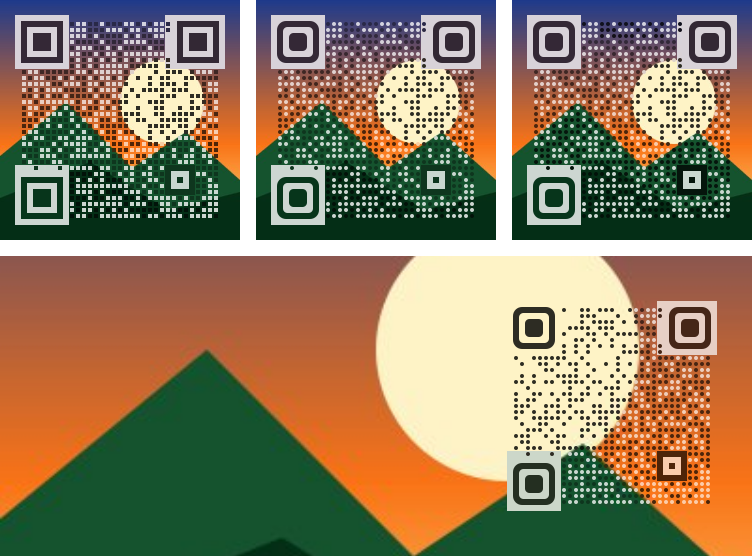

# QR Code Styling (Node)

[](https://www.npmjs.com/package/qr-code-styling-node)
[](https://github.com/ducminhquan/qr-code-styling/actions/workflows/ci.yml)

Styled QR codes from one options object: dots, corners, colors, gradients, logos, frames, labels, round codes
and QR art. Works in the browser (canvas or SVG) and on Node.js, with a single dependency.

**[Try it in the playground](https://ducminhquan.github.io/qr-code-styling/)** — change options live, download
the result and copy the code.

<p float="left">


</p>


**Why this library**

- **One options object.** Everything is an option; nothing to compose or subclass.
- **Framework-free and light.** One dependency (`qrcode-generator`). React and Vue wrappers are optional.
- **Pretty out of the box.** 14 dot styles, rounded corners, gradients, logos, frames, labels, round, heart and other shaped codes, and QR art.
- **Runs anywhere.** Browser canvas or SVG; on Node, SVG works with no extra packages, PNG with `resvg` or `node-canvas`.
- **Checks itself.** `check()` flags low contrast, big logos and tiny prints instantly; `verify()` decodes the result so you know a styled code still scans.
- **Ready for shops.** VietQR bank transfers with ready-made payment cards, GS1 Digital Link product codes, and printable label sheets (PDF) from a CSV file, in code or with `npx`.
- **Backward compatible.** Code written for 1.5.0 (or for the original `qr-code-styling`) keeps working and draws the same picture. New behaviour is always opt-in.

`qr-code-styling-node` is an independently maintained project. It started as a fork of
[qr-code-styling](https://github.com/kozakdenys/qr-code-styling) by Denys Kozak and keeps its API.
See [CHANGELOG.md](CHANGELOG.md) for what changed. Found a bug or have an idea?
[Open an issue](https://github.com/ducminhquan/qr-code-styling/issues).

## Contents

- [Installation](#installation)
- [Quick start](#quick-start): [browser](#in-the-browser), [bundler / TypeScript](#with-a-bundler-or-typescript), [React and Vue](#react-and-vue), [Node.js](#on-nodejs)
- [Guides and API reference](#guides-and-api-reference)
- [Upgrading from 1.5.0](#upgrading-from-150)
- [Development](#development)

## Installation

```
npm install qr-code-styling-node
```

Or load it from a CDN with a `<script>` tag. It defines a global `QRCodeStyling`:

```html
<script src="https://unpkg.com/qr-code-styling-node/lib/qr-code-styling.js"></script>
```

## Quick start

### In the browser

```html
<div id="qr"></div>
<script src="https://unpkg.com/qr-code-styling-node/lib/qr-code-styling.js"></script>
<script>
  const qrCode = new QRCodeStyling({
    width: 300,
    height: 300,
    type: "svg",
    data: "https://nhathuoclongchau.com.vn",
    image: "https://example.com/logo.svg",
    dotsOptions: { type: "rounded", color: "#1d4ed8" },
    cornersSquareOptions: { type: "extra-rounded" },
    backgroundOptions: { color: "#ffffff" },
    imageOptions: { crossOrigin: "anonymous", margin: 8 }
  });

  qrCode.append(document.getElementById("qr"));
  // later: qrCode.update({ data: "https://fptshop.com.vn" });
  // qrCode.download({ name: "qr", extension: "png" });
</script>
```

### With a bundler or TypeScript

```js
import QRCodeStyling, { dotTypes, payload } from "qr-code-styling-node";

const qrCode = new QRCodeStyling({ data: "https://example.com", dotsOptions: { type: dotTypes.fluid } });
qrCode.append(document.getElementById("qr"));
```

The package ships an ES module build (`import`), a CommonJS/UMD build (`require` and `<script>`) and TypeScript
types for every option.

### React and Vue

The core stays framework-free. Thin wrappers (about 2 KB each) ship in the same package; React and Vue are
optional peer dependencies.

```jsx
import { useRef } from "react";
import { QRCode } from "qr-code-styling-node/react";

function Poster() {
  const qr = useRef();
  return (
    <>
      <QRCode ref={qr} options={{ data: "https://example.com", dotsOptions: { type: "fluid" } }} />
      <button onClick={() => qr.current.download({ extension: "png" })}>Download</button>
    </>
  );
}
```

```vue
<script setup>
import { ref } from "vue";
import { QRCode } from "qr-code-styling-node/vue";

const qr = ref();
const options = ref({ data: "https://example.com", shape: "circle" });
</script>

<template>
  <QRCode ref="qr" :options="options" @update="(qrCode) => console.log('drawn', qrCode)" />
  <button @click="qr.share({ name: 'qr' })">Share</button>
</template>
```

Both redraw only when the options really change: a new but equal object does not redraw. The React ref is the
`QRCodeStyling` instance (with an `onUpdate` prop called after each draw); the Vue ref exposes `qrCode`,
`download`, `share` and `getRawData`, and the component emits `update`.

**Server rendering.** With Next.js, Remix, Nuxt or plain Vue SSR the code is already in the server HTML, so it
shows before any JavaScript runs; the browser then swaps in the live code without hydration warnings.

- Vue draws every code on the server, logo, frame and label included.
- React renders synchronously, so it puts plain codes (dots, corners, colors, gradients, shapes) in the HTML by
  itself. For a code with a logo, art, a frame or a label, make the markup in a server component or loader and
  pass it as `svg`:

```jsx
// Next.js app router: a server component
import QRCodeStyling from "qr-code-styling-node";
import { QRCode } from "qr-code-styling-node/react";

export default async function Poster() {
  const options = { data: "https://example.com", image: "https://example.com/logo.png" };
  const svg = await new QRCodeStyling({ ...options, type: "svg" }).getSVGString();
  return <QRCode options={options} svg={svg} />;
}
```

### On Node.js

SVG works with no extra packages. `getRawData` returns a `Buffer` on Node.

```js
const QRCodeStyling = require("qr-code-styling-node");
const fs = require("fs");

const qrCode = new QRCodeStyling({
  type: "svg",
  data: "https://example.com",
  image: "https://example.com/logo.png", // data URLs and http(s) URLs work (remote images use fetch)
  dotsOptions: { type: "rounded", color: "#4267b2" },
  imageOptions: { saveAsBlob: true, margin: 8 } // embeds the logo inside the SVG
});

qrCode.getRawData("svg").then((buffer) => fs.writeFileSync("qr.svg", buffer));
```

For PNG, pick one of two optional packages (neither is a dependency of this library):

- **`@resvg/resvg-js`**: prebuilt binaries, nothing to compile. PNG only.

  ```js
  const { Resvg } = require("@resvg/resvg-js");
  const png = await new QRCodeStyling({ data: "https://example.com", resvg: Resvg }).getRawData("png");
  ```

- **`canvas`** (node-canvas): PNG, JPEG and WebP. Needed for QR art on a server.

  ```js
  const nodeCanvas = require("canvas");
  const png = await new QRCodeStyling({ data: "https://example.com", nodeCanvas }).getRawData("png");
  ```

The 1.5.0 way with `jsdom` still works. `jsdom` is no longer needed for SVG, which is about 6x faster without it.

## Guides and API reference

Each feature has a guide with examples and pictures:

- [Dots and corners](https://github.com/ducminhquan/qr-code-styling/blob/master/docs/guides.md#dots-and-corners)
- [Frames and labels](https://github.com/ducminhquan/qr-code-styling/blob/master/docs/guides.md#frames-and-labels)
- [Round codes and other shapes](https://github.com/ducminhquan/qr-code-styling/blob/master/docs/guides.md#round-codes-and-other-shapes)
- [QR art](https://github.com/ducminhquan/qr-code-styling/blob/master/docs/guides.md#qr-art)
- [Wi-Fi, contacts, events and more](https://github.com/ducminhquan/qr-code-styling/blob/master/docs/guides.md#wi-fi-contacts-events-and-more)
- [VietQR bank transfers](https://github.com/ducminhquan/qr-code-styling/blob/master/docs/guides.md#vietqr-bank-transfers)
- [GS1 Digital Link product codes](https://github.com/ducminhquan/qr-code-styling/blob/master/docs/guides.md#gs1-digital-link-product-codes)
- [Download and share](https://github.com/ducminhquan/qr-code-styling/blob/master/docs/guides.md#download-and-share)
- [Checking that a code scans](https://github.com/ducminhquan/qr-code-styling/blob/master/docs/guides.md#checking-that-a-code-scans)
- [Printing many codes](https://github.com/ducminhquan/qr-code-styling/blob/master/docs/guides.md#printing-many-codes)
- [Command line](https://github.com/ducminhquan/qr-code-styling/blob/master/docs/guides.md#command-line)
- [Accessibility](https://github.com/ducminhquan/qr-code-styling/blob/master/docs/guides.md#accessibility)
- [Smaller SVG files](https://github.com/ducminhquan/qr-code-styling/blob/master/docs/guides.md#smaller-svg-files)
- [Plugins](https://github.com/ducminhquan/qr-code-styling/blob/master/docs/guides.md#plugins)

Every option, method and export is in the **[API reference](https://github.com/ducminhquan/qr-code-styling/blob/master/docs/api.md)**.

## Upgrading from 1.5.0

Nothing to change: the same options draw the same picture, and every 1.5.0 entry point still works, including
`require("qr-code-styling-node/lib/qr-code-styling.common.js")`. A test suite compares the output with 1.5.0
pixel by pixel. Things you can now drop or use:

- **`jsdom` is no longer needed** for SVG on Node, and SVG is about 6x faster without it.
- **`resvg`** gives PNG on a server without the native `canvas` package.
- **Text with accents** is now encoded as UTF-8. 1.5.0 kept only one byte per character, so Vietnamese, emoji and
  CJK scanned as garbled text, and Latin-1 accents ("Cà phê", "Café") were not read by some scanners. Plain ASCII
  codes are unchanged. To get the 1.5.0 bytes for Latin-1 text, pass `qrOptions: { encoding: "latin1" }`
  (since 2.0.1).

## Development

```
npm install
npm test          # unit, compatibility and scan tests (vitest)
npm run lint      # eslint + prettier
npm run build     # lib/: UMD, CommonJS, ES module, React and Vue wrappers, types
npm run size      # gzip size of each bundle against its budget (also run in CI)
npm run playground # builds the playground into site/
npm start         # dev server
npm run commit    # write a commit message step by step (commitizen)
```

Commit messages follow [Conventional Commits](https://www.conventionalcommits.org/) (`feat(vietqr): ...`,
`fix: ...`, `docs: ...`). `npm install` sets up a git hook that checks each message with commitlint.

Keeping the package light is one of its reasons to exist: `scripts/check-size.mjs` holds a gzip budget per
bundle and CI fails when a change goes over it. Raise a budget only on purpose, in the commit that needs it.

`npm run art-examples`, `blend-examples`, `circle-examples`, `dot-examples`, `retail-examples`, `style-examples` and `template-examples` regenerate the
pictures in the README and the guides.

**Releasing.** Bump the version and add its section to `CHANGELOG.md`, merge to `master`, then run the
"Publish to npm" workflow with that version. It checks the CHANGELOG section exists, stages the package on npm
(approve it on npmjs.com with 2FA), tags the commit and creates the GitHub release with the CHANGELOG section as
its notes.

## License

[MIT License](LICENSE). Copyright (c) 2019 Denys Kozak (original qr-code-styling) and qr-code-styling-node contributors.
