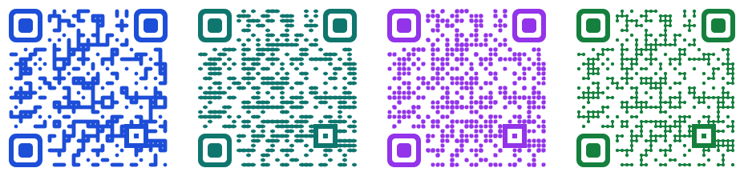
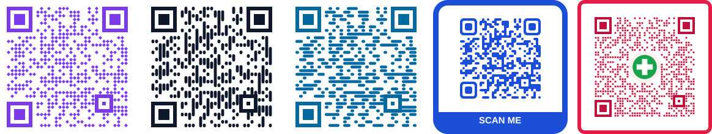
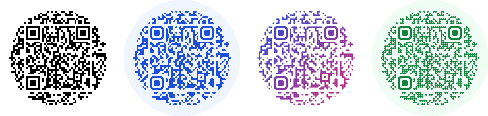
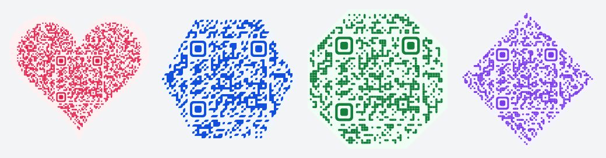
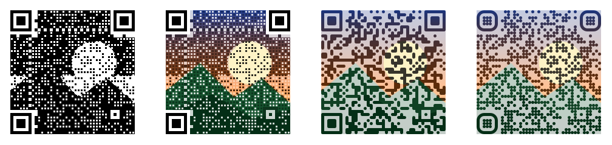
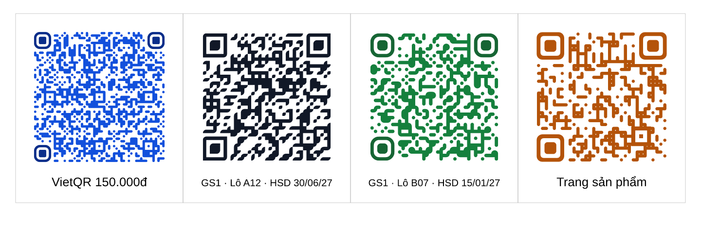
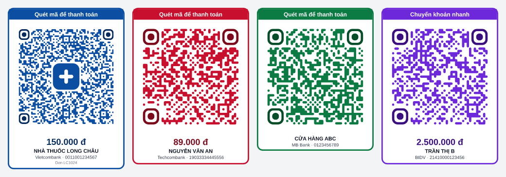

# Guides

How to use each feature of `qr-code-styling-node`. Options are listed in the [API reference](api.md); install and quick start are in the [README](../README.md).

## Dots and corners



`dotsOptions.type` sets the module style:

Group      |Types
-----------|----------------------------------------------------------------------------------------
Classic    |`square` (default), `dots`, `rounded`, `extra-rounded`, `classy`, `classy-rounded`
Geometric  |`diamond`, `small-square`, `vertical-lines`, `horizontal-lines`
Connected  |`fluid` (soft strokes), `wave` (rows of soft beads), `blob` (hand-drawn), `circuit` (pads and traces)

The finders (the three big squares) use `cornersSquareOptions.type` (`square`, `dot`, `extra-rounded`, `rounded`)
and `cornersDotOptions.type` (`square`, `dot`, `rounded`). When you don't set them, the finders are drawn with the
dot style. With the geometric and connected types they are drawn solid instead (rounded for connected types), so
the code keeps scanning.

Every part takes a `color` or a `gradient`:

```js
new QRCodeStyling({
  data: "https://example.com",
  dotsOptions: {
    type: "fluid",
    gradient: { type: "linear", rotation: Math.PI / 4, colorStops: [{ offset: 0, color: "#1d4ed8" }, { offset: 1, color: "#db2777" }] }
  },
  cornersSquareOptions: { type: "rounded", color: "#1d4ed8" },
  cornersDotOptions: { type: "rounded", color: "#db2777" },
  backgroundOptions: { color: "#ffffff" }
});
```

## Frames and labels



```js
new QRCodeStyling({
  data: "https://example.com",
  dotsOptions: { type: "rounded", color: "#1d4ed8" },
  frameOptions: { color: "#1d4ed8", radius: 24 },
  labelOptions: { text: "QUÉT ĐỂ MUA" }, // any Unicode text
  image: "https://example.com/logo.svg",
  imageOptions: { backgroundColor: "#ffffff", backgroundRadius: 0.5 } // a plate behind the logo
});
```

The frame and label are drawn inside `width` x `height`, and the code shrinks to fit.

For a label on top and another at the bottom, pass an array. A label can have several lines, each with its own
size, weight and color, and `background: "none"` puts the text on the card instead of a colored band:

```js
new QRCodeStyling({
  data: "https://example.com",
  width: 600,
  height: 800,
  frameOptions: { color: "#0b4ea2", radius: 30 },
  labelOptions: [
    { position: "top", text: "Quét mã để thanh toán" },
    {
      position: "bottom",
      background: "none",
      lines: [
        { text: "150.000 đ", fontSize: 44, fontWeight: 800, color: "#0b4ea2" },
        { text: "NHÀ THUỐC LONG CHÂU", fontSize: 26, color: "#111827" },
        { text: "Vietcombank · 0011001234567", fontSize: 22, fontWeight: 400, color: "#374151" }
      ]
    }
  ]
});
```

## Round codes and other shapes



`shape: "circle"` draws a round code. The real code stays square in the middle, with an empty ring around it so
scanners still find it. The rest of the circle is filled with decorative dots in the same style, and the
background becomes a circle. The decoration is the same every time for the same data.

```js
new QRCodeStyling({ data: "https://example.com", shape: "circle", dotsOptions: { type: "rounded" } });
```

A round code has smaller modules than a square one of the same size: keep it at least about 240 px for short data,
and check it with `verify()`.



`shape` also takes `"heart"`, `"hexagon"`, `"octagon"` and `"diamond"`, built the same way: the code stays square
in the middle with its quiet ring, the rest of the outline is decoration, and the background is cut to the outline.

```js
new QRCodeStyling({
  data: "https://example.com",
  shape: "heart",
  dotsOptions: { type: "rounded", color: "#e11d48" },
  backgroundOptions: { color: "#fff1f2" }
});
```

The heart needs the most room around the code, so its modules are smallest: give it 400 px or more, and short data.

## QR art



`art` blends a picture into the code. There are three modes:

- **`halftone`** (default): the picture is redrawn as fine pixels, with each module kept in the middle.
  Use `colored: true` to keep the picture's colors.
- **`colorize`**: dots keep their shape (any dot type) and are painted with a darkened copy of the picture, over a
  light copy of it.
- **`blend`**: the picture fills the whole image like an illustration. Dots are drawn only where the picture is
  not already dark or light enough for the code. Finders take a dark color from the picture and sit on a light
  plate. Use `placement` to put the code in one part of a larger picture.

```js
// A poster with the code in the bottom right corner
new QRCodeStyling({
  width: 760,
  height: 300,
  data: "https://example.com",
  dotsOptions: { type: "dots" }, // round dots give round finders
  art: { image: "poster.jpg", mode: "blend", placement: { x: 510, y: 40, size: 220 } }
});

// A photo inside the code
new QRCodeStyling({
  data: "https://example.com",
  qrOptions: { errorCorrectionLevel: "H" }, // recommended for art
  art: { image: "https://example.com/photo.jpg", colored: true },
  imageOptions: { crossOrigin: "anonymous" } // the picture must be readable by a canvas
});
```

QR art reads the picture's pixels, so it needs a canvas. It works as is in the browser, and on Node it needs
`nodeCanvas`. Pictures from another origin need CORS (`crossOrigin`). Always check art with
`verify({ decoder, adjust: true })`: pictures with large mid-grey areas, or modules under about 7 px, may need more
`contrast`, a larger size or a higher error correction level.

## Wi-Fi, contacts, events and more

`payload` (also `QRCodeStyling.payload` for `<script>` users) builds the text that phone cameras understand.
Pass the result as `data`.

```js
import { payload } from "qr-code-styling-node";

payload.wifi({ ssid: "LongChau-Guest", password: "secret" }); // WIFI:T:WPA;S:LongChau-Guest;P:secret;;
payload.vCard({ firstName: "Quân", lastName: "Nguyễn", phone: "+84900000000", email: "a@example.com" });
payload.event({ title: "Khai trương", start: "2026-12-01T09:00:00+07:00", end: "2026-12-01T11:00:00+07:00" });
payload.email({ to: "cskh@example.com", subject: "Hỏi đáp" });
payload.phone("1800 6928");
payload.sms({ number: "+84900000000", message: "Xin chào" });
payload.geo({ latitude: 10.7769, longitude: 106.7009 });
```

Special characters are escaped as each format requires. Any text with accents (Vietnamese, French, emoji,
CJK) is encoded as UTF-8, which is what scanners expect.

## VietQR bank transfers



A VietQR payment code, two GS1 product labels and a product page link, laid out with
[`sheet()`](#printing-many-codes) (`npm run retail-examples`).

`payload.vietQR()` builds the NAPAS VietQR code that every Vietnamese banking app scans (EMVCo format, with its
checksum). Leave out `amount` for a static code the payer fills in; with `amount` the app fills it for them.

```js
payload.vietQR({
  bank: "VCB",                         // short name from payload.vietQRBanks, or the 6-digit NAPAS BIN "970436"
  account: "0011001234567",
  amount: 150000,                      // VND, optional
  message: "Thanh toán đơn LC123"      // accents are removed: banks expect plain text
});
// "00020101021238570010A000000727...6304XXXX"

payload.vietQR({ bank: "970422", account: "9704221234567890", type: "card" }); // to a card number
```

`payload.vietQRBanks` lists the BINs of common banks (VCB, CTG, BIDV, AGRIBANK, TCB, MB, ACB, VPB, TPB, STB,
HDB, VIB, SHB, OCB, MSB, SEAB, EIB, LPB, NAB). For other banks pass the BIN from the NAPAS list. Always scan a
new payment code with a banking app before printing it.

### Ready-made payment cards



`templates.vietQR()` takes the same fields plus a few for the design, and returns options for a finished card:
theme colors, rounded dots, a header, and the amount, account name, bank and description under the code.

```js
import QRCodeStyling, { templates } from "qr-code-styling-node";

const qrCode = new QRCodeStyling(
  templates.vietQR({
    bank: "VCB",
    account: "0011001234567",
    amount: 150000,
    message: "Don LC1024",
    accountName: "Nhà thuốc Long Châu", // shown on the card, accents allowed
    theme: "blue",                      // blue, red, green, purple, orange, black, or color: "#0b5394"
    logo: "https://example.com/shop-logo.svg", // optional, in the middle of the code
    title: "Quét mã để thanh toán",     // header; "" for none
    width: 600                          // the height follows from the texts
  })
);

// It returns plain options, so you can change or add any of them:
new QRCodeStyling({ ...templates.vietQR({ bank: "MB", account: "0123456789" }), shape: "heart", type: "svg" });
```

`layout: "plain"` gives just the styled code, without frame or texts. No bank logos are bundled: pass a logo you
are allowed to use. `formatVND(150000)` gives `"150.000 đ"` and `vietQRBankNames` maps BINs to bank names.

## GS1 Digital Link product codes

`payload.gs1()` builds a [GS1 Digital Link](https://www.gs1.org/standards/gs1-digital-link): one QR code on the
pack that tills read as the GTIN (with batch and expiry) and phones open as a web page.

```js
payload.gs1({ gtin: "8935049500131", lot: "A12", expiry: "2027-06-30" });
// "https://id.gs1.org/01/08935049500131/10/A12?17=270630"

payload.gs1({
  gtin: "8935049500131",
  serial: "000123",
  domain: "https://qr.example.vn",     // your own resolver, so the phone opens your product page
  extra: { "3103": "000500" }          // any other GS1 application identifier
});
```

The GTIN's check digit is verified. `expiry` and `bestBefore` take a `Date`, `"YYYY-MM-DD"` or `"YYMMDD"`.

## Download and share

```js
qrCode.download({ name: "qr", extension: "svg" }); // png, jpeg, webp or svg

// On phones: opens the share sheet with the code as an image file.
// Where sharing files is not supported, it downloads the file instead.
const result = await qrCode.share({ name: "wifi", extension: "png", title: "Wi-Fi Long Châu" });
// "shared", "cancelled" or "downloaded"

const blob = await qrCode.getRawData("png"); // Blob in the browser, Buffer on Node
```

## Checking that a code scans

`check()` looks for the usual reasons a styled code does not scan, without drawing or decoding anything: low
contrast between dots and background (every gradient stop and corner color is checked), light dots on a dark
background, a logo too large for the error correction level, a missing quiet zone, modules too small on screen
or in print, and codes too dense. It is synchronous and works everywhere.

```js
const result = qrCode.check({ printWidthMm: 25 }); // or QRCodeStyling.check(options, { printWidthMm: 25 })
// {
//   ok: false,                       // false when there is an "error"
//   issues: [{ level: "error", code: "low-contrast", message: "Code colors and background are too close ..." }],
//   version: 4, modules: 33, moduleSize: 9, moduleSizeMm: 0.76, contrast: 1.6
// }
```

Levels are `"error"` (likely will not scan), `"warning"` (may fail on some phones or prints) and `"info"`
(depends on where the code is placed). `printWidthMm` is the printed width of the whole image; add
`scanDistanceMm` (default 200) to check the size for the distance people will scan from.

`verify()` renders the code and decodes it with a decoder you pass in, so the library itself stays
dependency-free. Any decoder with the [jsQR](https://www.npmjs.com/package/jsqr) signature works.

```js
import jsQR from "jsqr";

await qrCode.verify({ decoder: jsQR });
// { readable: true, decoded: "https://example.com", attempts: 1 }

// For QR art: raise art.contrast step by step until the code scans, and keep that setting.
await qrCode.verify({ decoder: jsQR, adjust: true });
// { readable: true, decoded: "...", contrast: 0.8, attempts: 3 }
```

On Node, `verify()` needs `nodeCanvas` or `resvg` to draw the code. A decoder succeeding is a good sign, not a
guarantee: phone cameras are usually more forgiving than jsQR, but print size, light and glare matter too.

## Printing many codes

`qr-code-styling-node/print` lays codes out on pages for shelf labels, price tags or product stickers, as SVG or as
a PDF ready to print. Every code gets its own ids, so gradients and logos of different codes never mix.

```js
import { pdf, sheet, parseCSV, fillTemplate } from "qr-code-styling-node/print";
import { Resvg } from "@resvg/resvg-js"; // on a server; not needed in the browser

const products = parseCSV(fs.readFileSync("products.csv", "utf8")); // Excel exports with ; , or tabs work
const items = products.map((p) => ({
  data: fillTemplate("https://shop.example.vn/p/{sku}", p),
  caption: `${p.name} ${p.price}`
}));

const bytes = await pdf(items, {
  template: { dotsOptions: { type: "rounded", color: "#1250dc" }, image: logo }, // shared by every code
  page: "A4",           // A4, A5, A6, letter or { widthMm, heightMm }; orientation: "landscape"
  sizeMm: 30,           // printed width of each code
  gapMm: 5,
  marginMm: 10,
  cutLines: true,       // thin lines to cut labels apart
  dpi: 300,
  resvg: Resvg          // or nodeCanvas: require("canvas")
});
fs.writeFileSync("labels.pdf", bytes);

const pages = await sheet(items, { sizeMm: 30 }); // one SVG string per page, sized in mm
```

Each item can override any option of the template (for example its own logo). Captions shrink to fit the code
width. The PDF holds one image per page at `dpi`; for vector output use the SVG pages.

## Command line

The same features without writing code. PNG and PDF need `@resvg/resvg-js` (or `canvas`) installed.

```sh
# one code
npx qr-code-styling-node --data "https://example.com" -c style.json -o qr.svg
npx qr-code-styling-node --payload vietqr --set bank=VCB --set account=0011001234567 --set amount=50000 -o pay.png

# one file per CSV row, named by a column
npx qr-code-styling-node --csv products.csv --data-template "https://shop.example.vn/p/{sku}" --name "{sku}" -o out/ -f png

# a printable PDF of GS1 product codes (columns gtin, lot, expiry), with captions and a scan check
npx qr-code-styling-node --csv products.csv --payload gs1 --caption "{name} {price}" \
  --sheet --code-size 25 --cut-lines --check -o labels.pdf
```

`-c style.json` takes the same options as `new QRCodeStyling()`. `--payload` accepts `vietqr`, `gs1`, `wifi`,
`vcard`, `email`, `phone`, `sms` and `geo`, with fields from CSV columns or `--set key=value`. `--check` prints
problems and exits with code 1 when one is an error. `npx qr-code-styling-node --help` lists every option.

## Accessibility

A QR code is a picture, so screen readers say nothing useful about it unless it has a name. Pass `title` with
what the code does:

```js
new QRCodeStyling({
  data: payload.vietQR({ bank: "VCB", account: "0123456789", amount: 150000 }),
  title: "VietQR: pay 150.000 đ to Long Châu"
});
```

The SVG gets `role="img"`, `aria-label` and a `<title>` (browsers also show it as a tooltip); a canvas in the
browser gets `role="img"` and `aria-label`. The React and Vue components pass it through, including in
server-rendered HTML. Without `title` the output is exactly as before.

## Smaller SVG files

`svgOptions: { mergePaths: true }` draws all dots as one `<path>` instead of one element per module. The picture
is the same, and files are 12-59% smaller depending on the dot type. This helps when a page shows many codes.

```js
new QRCodeStyling({ type: "svg", data: "https://example.com", svgOptions: { mergePaths: true } });
```

## Plugins

A plugin is a plain object with two optional hooks:

- `configure(options)` returns option changes, which are merged in before drawing.
- `afterDraw(draw)` draws on top of the finished code, with the canvas context or the SVG element. It gets the
  code's area in pixels (`x`, `y`, `size`, `dotSize`, `count`), and that area accounts for frames.

```js
const ring = {
  name: "ring",
  configure: (options) => (options.margin < 24 ? { margin: 24 } : undefined),
  afterDraw: ({ type, area, context, svg, document }) => {
    const cx = area.x + area.size / 2;
    const cy = area.y + area.size / 2;
    const r = area.size * 0.75;
    if (type === "canvas") {
      context.beginPath();
      context.arc(cx, cy, r, 0, Math.PI * 2);
      context.strokeStyle = "#e11d48";
      context.stroke();
    } else {
      const circle = document.createElementNS("http://www.w3.org/2000/svg", "circle");
      Object.entries({ cx, cy, r, fill: "none", stroke: "#e11d48" }).forEach(([k, v]) => circle.setAttribute(k, v));
      svg.appendChild(circle);
    }
  }
};

new QRCodeStyling({ data: "https://example.com", plugins: [ring] });
```

Plugins run in order, and async `afterDraw` hooks are awaited. `configure` runs again on every `update()`, so it
should return the same changes for the same options. Check the result with `verify()` when a plugin draws near
the code.
